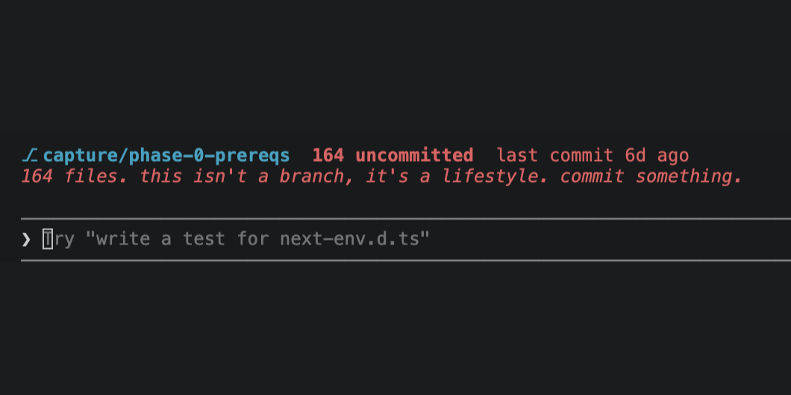

# claude-commit-nag

A [Claude Code mod](https://code.claude.com/docs/en/plugins/mods/create) that puts your git state in a band above the prompt, and roasts you when uncommitted work piles up.



It shows:
- your current branch
- how many files are uncommitted
- how long since your last commit
- a roast line when things get out of hand

| State | What you see |
|---|---|
| Nothing uncommitted | "clean tree. respect." in green |
| 20+ uncommitted files | "that's a lot of vibes and not a lot of commits." |
| No commit in 3+ days | "N days without a commit. your future self is filing a complaint." |
| 100+ uncommitted files | "N files. this isn't a branch, it's a lifestyle. commit something." |

It refreshes every 10 seconds and shows nothing outside a git repo.

## Install

Needs Claude Code 2.1.287 or later.

```sh
git clone https://github.com/AdityaUmale/claude-commit-nag ~/mods/claude-commit-nag
cd your-project
claude --plugin-dir ~/mods/claude-commit-nag
```

## Make it yours

Everything is in `hooks/register.js`, about 80 lines. Change the roast lines in `roast()`, the thresholds, or the refresh interval in `$.clock.every`. Claude Code hot-reloads the mod when you save.

## License

MIT
